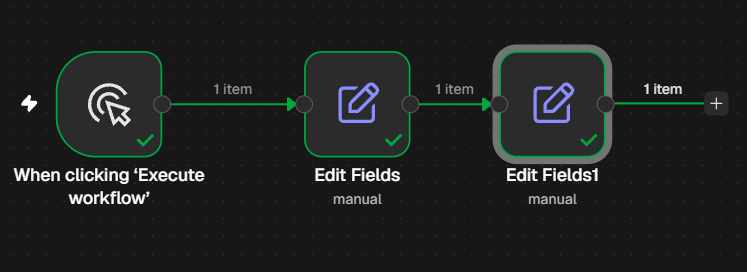

# n8n Foundations

This folder contains my practical implementations while learning **n8n workflow automation**, starting from fundamental concepts such as nodes, connections and triggers.

Each workflow is independently built, tested and exported from n8n Cloud.

## Learning Progress

| ID | Workflow | Concepts Covered | Status |
|---|---|---|---|
| L01 | My First Workflow | Manual Trigger, Edit Fields, workflow execution | Completed |
| L02 | Understanding Data Flow | Nodes, connections, data passing, Include Other Input Fields | Completed |
| L03A | Manual Trigger | Manual execution and execution history | Completed |
| L03B | Schedule Trigger | Automated, time-based execution | Completed |
| L03C | Webhook Trigger | HTTP POST requests, incoming JSON, webhook execution | Completed |

---

## L01 - My First Workflow

**Objective:** Build a basic n8n workflow and understand how nodes are connected.

**Nodes Used:**
- Manual Trigger
- Edit Fields

**What I Learned:**
- Creating a workflow.
- Adding and connecting nodes.
- Configuring fields using Edit Fields.
- Executing a workflow manually.
- Inspecting JSON output.

**Expected Output:**

```json
{
  "student_name": "Student 1",
  "course": "n8n",
  "learning_status": "Started"
}
```

**Workflow Files:**
- `L01.json`
- `L01.png`

---

## L02 - Understanding Data Flow

**Objective:** Understand how data moves between connected nodes and how subsequent nodes can modify existing data.

**Nodes Used:**
- Manual Trigger
- Edit Fields
- Edit Fields

**What I Learned:**
- How connections pass data between nodes.
- How to inspect the output of individual nodes.
- How to add new fields to existing data.
- How Include Other Input Fields preserves incoming fields.

**Expected Output:**

```json
{
  "customer_name": "Aadesh",
  "email": "aadesh@example.com",
  "age": 22,
  "customer_type": "Premium",
  "account_status": "Active"
}
```

**Workflow Files:**
- `L02.json`
- `L02.png`

---

## L03A - Manual Trigger

**Objective:** Understand how a workflow starts through manual execution and how n8n records individual executions.

**Nodes Used:**
- Manual Trigger
- Edit Fields

**What I Learned:**
- Manually starting a workflow.
- Understanding the execution lifecycle.
- Inspecting execution status.
- Viewing execution history.
- Understanding the difference between a workflow and an execution.

**Testing:**

The workflow was manually executed three times to observe separate execution records in n8n.

**Workflow Files:**
- `L03A.json`
- `L03A.png`

---

## L03B - Schedule Trigger

**Objective:** Build an automatically triggered workflow that executes according to a configured schedule.

**Nodes Used:**
- Schedule Trigger
- Edit Fields

**Configuration:**
- Trigger: Every minute.
- Interval: 1 minute.

**What I Learned:**
- Configuring time-based triggers.
- Understanding scheduled executions.
- Activating and deactivating workflows.
- Monitoring automatic executions.

**Testing:**

The workflow was activated and monitored for approximately 2–3 minutes. Multiple executions were observed in the execution history before deactivating it.

**Workflow Files:**
- `L03B.json`
- `L03B.png`

---

## L03C - Webhook Trigger

**Objective:** Understand how an external application can trigger an n8n workflow by sending an HTTP request.

**Nodes Used:**
- Webhook
- Edit Fields

**Webhook Configuration:**

| Setting | Value |
|---|---|
| HTTP Method | POST |
| Path | student-registration |
| Authentication | None (learning exercise) |
| Response | Immediately |

**How the Workflow Was Executed:**

Unlike Manual Trigger, the Webhook workflow was started by sending an HTTP POST request from Windows PowerShell.

**Step 1:** Open the Webhook node in n8n and select Listen for Test Event.

**Step 2:** Copy the Webhook Test URL.

**Step 3:** Open Windows PowerShell and send a POST request containing student information.

```powershell
$body = @{
    student_name = "Aadesh"
    email = "aadesh@example.com"
    age = 22
} | ConvertTo-Json

Invoke-RestMethod `
    -Uri "YOUR_WEBHOOK_TEST_URL" `
    -Method POST `
    -ContentType "application/json" `
    -Body $body
```

Replace `YOUR_WEBHOOK_TEST_URL` with the actual Test URL generated by n8n.

**Step 4:** n8n received the incoming JSON data through the Webhook node.

**Step 5:** Edit Fields added additional fields while preserving the incoming student information.

**Expected Output:**

```json
{
  "student_name": "Aadesh",
  "email": "aadesh@example.com",
  "age": 22,
  "registration_status": "Received",
  "source": "Webhook",
  "course": "n8n"
}
```

**What I Learned:**
- Understanding webhooks.
- HTTP POST requests.
- Sending JSON data from PowerShell.
- Test URL versus Production URL.
- Receiving external data in n8n.
- Preserving and transforming incoming data.

**Workflow Files:**
- `L03C.json`
- `L03C.png`

---

## Concepts Covered So Far

- Workflow fundamentals
- Nodes and connections
- Manual execution
- JSON output
- Data flow between nodes
- Edit Fields
- Include Other Input Fields
- Execution history
- Schedule-based automation
- Webhook triggers
- HTTP POST requests
- External JSON data handling

## Technologies and Tools

- n8n Cloud
- JSON
- JavaScript (introductory)
- Windows PowerShell
- GitHub

## Upcoming Learning Topics

- Understanding JSON and data structures
- Arrays, objects and multiple items
- Expressions and dynamic data mapping
- Code node fundamentals
- Data transformation
- Conditional logic
- API integrations

---

**Learning Approach:** Every workflow is built practically, tested with sample data, documented and exported to GitHub as part of my n8n learning portfolio.


## Workflow Gallery

### L01 - First Workflow


### L02 - Data Flow


### L03A - Manual Trigger


### L03B - Schedule Trigger


### L03C - Webhook Trigger

