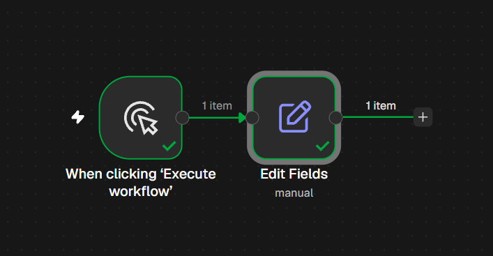

# L01 - My First Workflow

## Workflow Overview
My first n8n workflow using Manual Trigger and Edit Fields.

## Nodes Used
- Manual Trigger
- Edit Fields

## Workflow Screenshot

## Concepts Learned
- Workflow fundamentals
- Nodes and connections
- Manual execution
- JSON output
